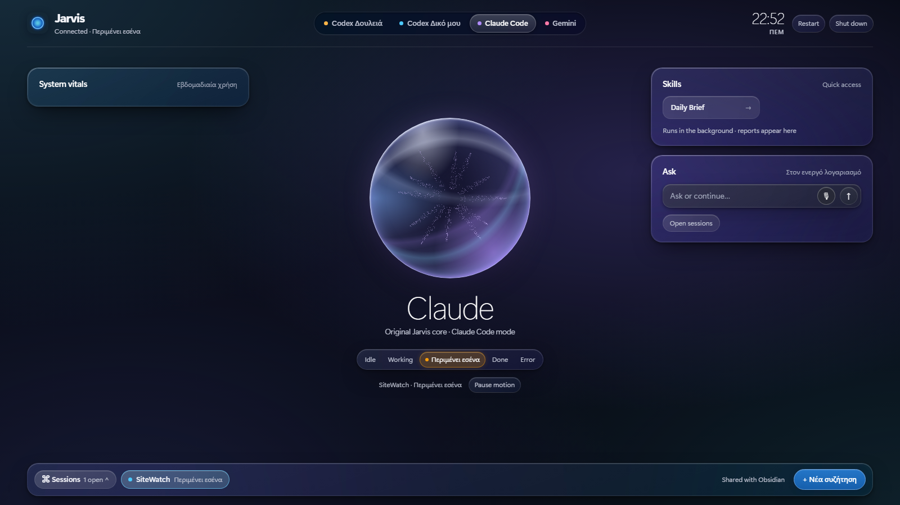
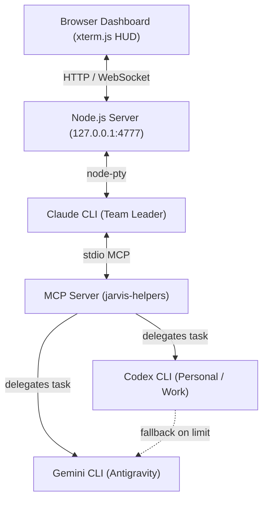

English | [Ελληνικά](README.el.md)

# Jarvis



A local dashboard where one AI agent (Claude) acts as team leader and delegates coding and research work to other AI agents (Codex, Gemini) through an MCP server, with automatic fallback when an account hits its usage limit.

## Why I built it

I juggle multiple AI subscriptions across different providers, each with distinct rate limits, pricing models, and specialized strengths. Switching between separate browser tabs and standalone terminals was slow and fragmented, so I wanted a centralized workspace to run them side by side. Jarvis coordinates them as an automated team, letting a primary reasoning agent orchestrate workflows and offload implementation tasks to secondary models.

## Features

- **Terminal sessions in the browser**: Interactive PTY terminal sessions powered by xterm.js and node-pty over WebSockets, letting you interact directly with CLI agents.
- **Multi-agent delegation via MCP**: Exposes a local Model Context Protocol (MCP) server (`jarvis-helpers`) so the lead agent can invoke helper agents (`ask_codex`, `ask_codex_work`, `ask_gemini`) for code review, edits, and research.
- **Automatic quota fallback**: If a helper hits its rate or usage limit, tasks cascade automatically through a defined fallback order (Codex Personal -> Codex Work -> Gemini).
- **Work and Personal account separation**: Strict policy isolation preventing personal AI helpers from accessing work-designated project directories and vice versa.
- **Live usage tracking**: Monitors 5-hour and weekly quota usage percentages, token counters, and reset windows parsed directly from CLI session logs.
- **Visual agent states**: Real-time canvas orb and state indicators reflecting whether each agent is idle, working, waiting for user input, or in an error state.
- **In-browser voice dictation**: Web Speech API integration to dictate prompts and commands directly into active terminal sessions.
- **Phone access through Tailscale Serve**: Secure remote access from a mobile device over an encrypted Tailnet with host verification and user identity headers.
- **Restart with session restore**: In-app restart functionality that captures active terminal sessions and restores them automatically upon server reboot.

## How it works

Jarvis runs a local Node.js server (`src/main.js`) on `127.0.0.1:4777`. The browser frontend connects via WebSockets to manage pseudo-terminal processes (`node-pty`) attached to `xterm.js` clients. Configuration for accounts, projects, and permissions is defined in `jarvis.config.json`. The lead agent communicates with helpers through a stdio JSON-RPC MCP server (`scripts/helpers-mcp.js`).



## Tech stack

Node.js (ES modules), WebSocket (ws), node-pty, xterm.js, Model Context Protocol (MCP), Vanilla JS / CSS, PowerShell.

## Testing

Run tests with `npm test` (or `npm.cmd test` on Windows). The suite contains 260+ tests using Node's built-in test runner (`node --test`), covering policy enforcement, MCP handlers, terminal multiplexing, usage parsers, and server endpoints.

## Getting started

Windows only. Requires Node.js 20+ (LTS).

1. Run the setup script in PowerShell to install dependencies and create desktop shortcuts:
   ```powershell
   powershell -ExecutionPolicy Bypass -File scripts\setup.ps1
   ```
2. Log in once to each CLI provider:
   - Codex Personal: `$env:CODEX_HOME="$HOME\.codex-personal"; codex login`
   - Codex Work: `codex login`
   - Claude: `claude` (then run `/login`)
   - Gemini: `gemini` (or `agy`)
3. Launch Jarvis by double-clicking the **Jarvis** desktop shortcut or running `npm start`.

## Security notes

- Runs only on localhost (`127.0.0.1`) by default; never exposed directly to the public internet.
- Never stores API keys or raw credentials; all operations use the native session logins of the installed CLIs.
- Policy engine strictly blocks personal helpers from executing inside work project paths.
